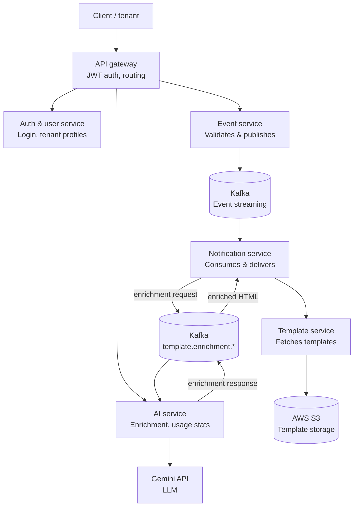

# NotifyHub

A multi-tenant notification platform built with microservices. Companies (tenants) register on the platform, configure their notification channels, and trigger notifications through a simple API call. The platform handles routing, template management, optional AI-based template enrichment, and delivery.

## Tech Stack

- Java 17, Spring Boot 3
- Spring Cloud Gateway (MVC), Netflix Eureka, Spring Cloud LoadBalancer
- Resilience4j (Circuit Breaker, Retry, Time Limiter)
- Apache Kafka
- MySQL
- Google Gemini API (LLM template enrichment), Spring WebClient
- Spring Boot Actuator
- Docker, Docker Compose
- AWS S3, EC2, IAM
- JWT (Spring Security)

## Architecture

8 Spring Boot services: 6 business microservices with their own MySQL databases, an API Gateway as the single public entry point, and a Eureka discovery server. Services register with Eureka on startup and are resolved by name rather than fixed host:port.

| Service | Responsibility |
|---------|---------------|
| api-gateway | Single entry point, JWT validation, request routing |
| discovery-server | Eureka service registry |
| auth-service | Tenant registration, login, JWT issuance |
| user-service | Tenant profiles, subscriptions |
| event-service | Receives trigger requests, publishes to Kafka |
| notification-service | Consumes Kafka events, requests AI enrichment, sends email or webhook |
| template-service | Stores and retrieves HTML templates via AWS S3 |
| ai-service | Enriches templates with Gemini, logs token usage and latency, exposes usage stats |



## Authentication

All endpoints except `/api/auth/register` and `/api/auth/login` require a JWT token, validated at the Gateway before any request reaches a downstream service.

```
Authorization: Bearer <token from /api/auth/login>
```

The Gateway extracts the tenant identity from the verified token and forwards it downstream as an `X-Tenant-Id` header — services trust this header, not any tenant ID supplied directly by the client.

## Running Locally

### Setup

1. Clone the repo
```bash
git clone https://github.com/Kalyan-Mandhula-Dev/NotifyHub
cd NotifyHub
```

2. Create a `.env` file in the root (never committed to git)
```env
MYSQL_ROOT_PASSWORD=your-password
JWT_SECRET=your-secret-key-string
JWT_EXPIRATION_MS=86400000
MAIL_USERNAME=your-email@gmail.com
MAIL_PASSWORD=your-gmail-app-password
AWS_REGION=ap-south-1
AWS_ACCESS_KEY=your-access-key
AWS_SECRET_KEY=your-secret-key
AWS_S3_BUCKET=notifyhub-templates
EUREKA_SERVER_URL=http://discovery-server:8761/eureka/
GEMINI_API_KEY=your-gemini-api-key
```

The Gemini key is read from the environment (`gemini.api-key=${GEMINI_API_KEY}`) and must never be hardcoded in a properties file or committed.

3. Build all services to create .jar files
```bash
cd api-gateway && mvn clean package -DskipTests && cd ..
cd discovery-server && mvn clean package -DskipTests && cd ..
cd auth-service && mvn clean package -DskipTests && cd ..
cd user-service && mvn clean package -DskipTests && cd ..
cd event-service && mvn clean package -DskipTests && cd ..
cd notification-service && mvn clean package -DskipTests && cd ..
cd template-service && mvn clean package -DskipTests && cd ..
cd ai-service && mvn clean package -DskipTests && cd ..
```

4. Start everything
```bash
docker compose up --build
```

All services, Eureka, MySQL, Kafka, and Zookeeper start with a single command.

### Service Ports

| Service | URL | Publicly Accessible |
|---------|-----|----------------------|
| api-gateway | http://localhost:8080 | Yes — only public entry point |
| discovery-server | http://localhost:8761 | Local/dev only |
| auth-service | internal only (8081) | No |
| user-service | internal only (8082) | No |
| event-service | internal only (8083) | No |
| notification-service | internal only (8084) | No |
| template-service | internal only (8085) | No |
| ai-service | internal only (8086) | No |
| Kafka | localhost:9092 | No |

All API requests go through `http://localhost:8080` (or `http://<ec2-ip>:8080` in deployment). Individual services are not reachable directly.

---

## API Reference

All requests below go through the Gateway at port 8080. Every endpoint except register/login requires the `Authorization: Bearer <token>` header.

### Auth Service

| Method | Endpoint | Description |
|--------|----------|-------------|
| POST | /api/auth/register | Register new tenant (no auth required) |
| POST | /api/auth/login | Login and get JWT token (no auth required) |
| GET | /api/auth/validate | Validate JWT token |

**Register**

*Request*
```json
POST /api/auth/register
{
  "companyName": "Swiggy",
  "email": "tech@swiggy.com",
  "password": "Swiggy@123"
}
```

*Response*
```json
{
  "token": "eyJhbGciOiJIUzI1NiJ9...",
  "tenantId": "f47ac10b-58cc-4372-a567-0e02b2c3d479",
  "email": "tech@swiggy.com",
  "message": "Registration Successful !!"
}
```

**Validate**
```
GET /api/auth/validate
Authorization: Bearer <token>
```

---

### User Service

| Method | Endpoint | Description |
|--------|----------|-------------|
| POST | /api/users/tenants | Create tenant profile |
| GET | /api/users/tenants/{id} | Get tenant |
| PUT | /api/users/tenants/{id} | Update tenant |
| DELETE | /api/users/tenants/{id} | Deactivate tenant |
| POST | /api/users/subscriptions | Add email or webhook subscription |
| GET | /api/users/subscriptions/{tenantId} | Get subscriptions |
| DELETE | /api/users/subscriptions/{id} | Remove subscription |

---

### Event Service

| Method | Endpoint | Description |
|--------|----------|-------------|
| POST | /api/events/trigger | Trigger a notification event |
| GET | /api/events/{tenantId} | Get all events for a tenant |

**Trigger Event**
```json
POST /api/events/trigger
Authorization: Bearer <token>
{
  "eventType": "order.placed",
  "channel": "EMAIL",
  "recipient": "kalyan@gmail.com",
  "payload": {
    "orderId": "SWG123",
    "restaurantName": "ABC Restaurant",
    "amount": 310
  }
}
```
`tenantId` is no longer sent in the body — the Gateway injects it from the verified token as `X-Tenant-Id`.

Returns `202 Accepted` immediately. Notification is processed asynchronously via Kafka.

**Channel options:** `EMAIL`, `WEBHOOK`

**Event status values:**

| Status | Meaning |
|--------|---------|
| RECEIVED | Saved to DB, not yet sent to Kafka |
| PUBLISHED | Successfully published to Kafka |
| FAILED | Kafka publish failed |

**Kafka Topics**

| Topic | Purpose |
|-------|---------|
| notification.email.send | Email events |
| notification.webhook.send | Webhook events |
| template.enrichment.request | notification-service → ai-service: template + payload to enrich |
| template.enrichment.response | ai-service → notification-service: enriched HTML, matched by correlation ID |

---

### Notification Service

Notification service has no trigger endpoint — all processing is Kafka-driven. REST endpoints are read-only.

| Method | Endpoint | Description |
|--------|----------|-------------|
| GET | /api/notifications/history/{tenantId} | Delivery history |
| GET | /api/notifications/stats/{tenantId} | Delivery stats |

**Stats Response**
```json
{
  "tenantId": "f47ac10b-58cc-4372-a567-0e02b2c3d479",
  "totalSent": 120,
  "totalFailed": 3,
  "totalPending": 0
}
```

**Delivery status values:**

| Status | Meaning |
|--------|---------|
| PENDING | Consumed from Kafka, processing started |
| SENT | Email or webhook delivered successfully |
| FAILED | Delivery failed — errorMessage populated |

---

### Template Service

| Method | Endpoint | Description |
|--------|----------|-------------|
| POST | /api/templates | Upload HTML template (multipart/form-data) |
| GET | /api/templates/resolve | Get template by tenantId and eventType |
| GET | /api/templates/tenant/{tenantId} | List all templates for a tenant |
| DELETE | /api/templates/{templateId} | Delete a template |

**Upload Template (Postman — form-data)**
```
tenantId      → f47ac10b-58cc-4372-a567-0e02b2c3d479
eventType     → order.placed
templateName  → order-confirmation
file          → order-confirmation.html  (file type)
```

**Resolve Template**
```
GET /api/templates/resolve?tenantId={tenantId}&eventType=order.placed
```

Returns the full HTML content of the template fetched from AWS S3.

**Sample template file**
```html
<html>
<body>
  <h2>Order Confirmation</h2>
  <p>Order ID: {{orderId}}</p>
  <p>Restaurant: {{restaurantName}}</p>
  <p>Amount: ₹{{amount}}</p>
</body>
</html>
```

`{{key}}` placeholders are replaced with values from the event payload before sending.

If template-service is unreachable or no template is found, notification-service falls back to a plain HTML table — delivery never fails because of a missing or unavailable template.

Templates remain the source of structure, compliance text and fallback copy. AI enrichment works inside that structure and never replaces it.

---

### AI Service

ai-service has no write endpoints — enrichment is Kafka-driven (see [AI Template Enrichment](#ai-template-enrichment)). Its REST endpoints are read-only usage stats, following the same pattern as the notification stats endpoint.

| Method | Endpoint | Description |
|--------|----------|-------------|
| GET | /api/ai/stats | Global AI usage across all tenants |
| GET | /api/ai/stats/{tenantId} | AI usage for a single tenant |

**Stats Response**
```json
{
  "tenantId": "f47ac10b-58cc-4372-a567-0e02b2c3d479",
  "totalCalls": 120,
  "totalCompleted": 112,
  "totalFailed": 8,
  "failureRate": 6.67,
  "totalPromptTokens": 98400,
  "totalCompletionTokens": 41200,
  "totalTokens": 139600,
  "avgLatencyMs": 2310.5
}
```

`tenantId` is `null` on the global endpoint. `failureRate` is a percentage: `totalFailed / (totalCompleted + totalFailed) × 100`.

**Usage log status values** (one row per logical enrichment request, stored in `usage_log`):

| Status | Meaning |
|--------|---------|
| COMPLETED | Gemini returned a full response (finish reason `STOP`) |
| FAILED | Call failed or response was invalid/partial — token counts are still recorded when Gemini returned them |

**Operational endpoints** (ai-service, internal only): Spring Boot Actuator exposes `/actuator/health`, `/actuator/circuitbreakers` and `/actuator/retries` for live breaker and retry state.

---

## AI Template Enrichment

For `EMAIL` events, notification-service can ask ai-service to rewrite the plain template into a warmer, better-styled version of the same message, using only the values in the event payload.

```
1. notification-service consumes the event and fetches the plain template
   from template-service.

2. It publishes an enrichment request (correlation ID, tenant, event type,
   payload, template HTML) to template.enrichment.request and registers a
   CompletableFuture keyed by the correlation ID.

3. It waits up to 4 seconds for the result.

4. ai-service consumes the request, builds the prompt, and calls Gemini
   (retry + circuit breaker). One usage_log row is written per logical
   request: tenant, event, model, prompt/completion tokens, latency, status.

5. On success, ai-service publishes the enriched HTML to
   template.enrichment.response. notification-service completes the matching
   future and sends the enriched email.

6. On timeout or any failure, notification-service falls back to the plain
   template populated with the payload. Exactly one email is sent either way.
```

**What the prompt enforces:** placeholders are replaced with payload values exactly as given (numbers, IDs, names, amounts, currency symbols never altered); legal, unsubscribe and compliance text is left unchanged; no links, images or sections are added or removed; no invented facts, offers or dates; unmatched placeholders are left as-is; output is raw HTML only, with no markdown fences or commentary.

**Prompt-injection handling:** the payload and template are explicitly treated as data, never instructions. Tested with injection payloads placed in payload fields (instruction override, fake system markers, system-prompt extraction, obfuscated input, markdown-escape attempts, attempts to tamper with amounts or strip compliance text). Injected text appeared only as literal data in the output; template structure and compliance text stayed intact.

---

## How It All Works Together

```
1. Example tenant: Swiggy

2. Swiggy registers → api-gateway (open route, no token needed) →
   auth-service creates credentials, calls user-service to create tenant profile

3. Swiggy subscribes to an event EMAIL -> user-service

4. Swiggy uploads an HTML template → template-service
   stores file in AWS S3, saves metadata in template_db

5. Swiggy triggers an event (order.placed) → api-gateway validates JWT,
   injects tenantId as a header, forwards to event-service →
   validates the tenant and subscriptions, saves to event_db,
   publishes to Kafka topic → returns 202 immediately

6. notification-service picks up the Kafka message,
   fetches the template from template-service (from S3)

7. For EMAIL events, notification-service requests AI enrichment over Kafka
   and waits up to 4 seconds; ai-service calls Gemini and replies with the
   enriched HTML, logging tokens and latency to usage_log

8. notification-service sends the enriched email, or the plain populated
   template if enrichment timed out or failed, and logs the result
   (SENT or FAILED) in notification_db
```

---

## Key Design Decisions

**API Gateway + Centralized Auth**

A Spring Cloud Gateway (MVC-based) is the single public entry point for all business services. It validates JWTs once, in one place, instead of duplicating auth logic across services, and injects the verified tenant identity downstream as a trusted header — so a tenant can never spoof another tenant's ID by editing a request body.

**Service Discovery**

All services register with a Eureka server on startup and are looked up by name instead of hardcoded `host:port`. This means a service can be scaled to multiple instances, or moved to a new host, with zero configuration changes anywhere else in the system.

**Fault Tolerance with Resilience4j**

The `notification-service → template-service` call is wrapped with Resilience4j: 3 retry attempts (500ms apart) for transient failures, a 2-second timeout to prevent hung threads, and a circuit breaker that opens after a 50% failure rate over a 10-call window to stop hammering a dead dependency. On exhausted retries, it falls back to a plain HTML table instead of failing the notification. This same pattern is established and intended to extend to the other inter-service calls (`auth-service → user-service`, `event-service → user-service`) going forward.

**Resilience on the Gemini Call**

The `ai-service → Gemini` call has its own retry and circuit breaker, verified against real Gemini 503/429 failures:

- *Retry:* 3 attempts, 1s initial wait, exponential backoff ×2. Only transient errors are retried (503, 429, connection/request errors, timeouts); a 404 or an invalid/partial response is never retried.
- *Circuit breaker:* count-based window of 10 calls, minimum 5 calls before evaluating, opens at a 50% failure rate, stays open 30s, then half-open with 3 trial calls. While open, calls fail instantly without reaching Gemini.
- *Placement matters:* retry and breaker live on methods called across bean boundaries (the retry on the Gemini client, the breaker on the enrichment service), because Resilience4j annotations only work through the Spring AOP proxy — an internal self-call would silently bypass them.
- *One log row per logical request:* retries happen inside the client, so a request that took 3 attempts still produces a single usage_log row and a single end-to-end latency measurement.
- *Reactor wrapping:* `.block()` wraps checked exceptions such as `TimeoutException` in a Reactor exception that Resilience4j's retry whitelist would never match. The client unwraps it to the real cause before rethrowing so timeouts are actually retried.
- *Fallback:* when the breaker is open or retries are exhausted, ai-service publishes nothing; notification-service's bounded wait expires and it sends the plain template.

**Async Request-Reply over Kafka with Bounded Wait**

AI enrichment is slow and can fail, so it is kept off the critical path. notification-service publishes a request carrying a correlation ID and waits on a `CompletableFuture` for at most 4 seconds; the response consumer completes the future matching that ID. The latency-versus-quality trade-off is explicit: richer emails when the AI answers in time, guaranteed delivery of the plain template when it does not. The response consumer uses its own listener container factory, separate from the delivery-event consumer, so its acknowledgement mode can differ while delivery events stay manually acknowledged.

**Provider Abstraction**

ai-service talks to the LLM through an `AiClient` interface (`generate(systemPrompt, userPrompt)` returning text plus prompt and completion token counts, and `getModelName()`). The Gemini client is the only implementation today. Swapping or adding a provider means implementing `AiClient` inside ai-service; the enrichment service, usage logging, Kafka contracts and notification-service's request/response DTOs do not change. A second provider has not been implemented yet, so the claim here is the decoupled design, not a proven provider swap.

**AI Usage Observability**

Every enrichment request writes one `usage_log` row (tenant, event, model, prompt tokens, completion tokens, latency, status). The stats endpoints aggregate that table globally and per tenant, which is the basis for token monitoring, latency tracking and per-tenant cost reporting. Dashboards are intentionally left to consumers of the API.

**Transactional Outbox Pattern**

Event-service saves the event and an outbox record in the same database transaction. A scheduler retries any unpublished records every 30 seconds. This ensures no event is lost even if Kafka is temporarily down.

**Manual Kafka Acknowledgement**

Notification-service only acknowledges a Kafka message after the notification is successfully delivered. If delivery fails, the message is not acknowledged and Kafka redelivers it.

**Service-owned Databases**

Each service has its own database. No service queries another service's database directly — data is accessed only through APIs.

---

## Known Limitations

- **Circuit-breaker rejections are not logged.** Calls rejected while the breaker is open never reach `usage_log`, so `failureRate` undercounts real failures during an outage.
- **No negative reply on failure.** When ai-service fails or fast-fails, it publishes nothing, so notification-service still waits the full 4 seconds before falling back.
- **Thinking tokens are not counted.** `totalCompletionTokens` uses Gemini's `candidatesTokenCount`, which excludes internal reasoning tokens, so it can undercount billed output.
- **Lost result after a successful call.** If Gemini succeeds (tokens logged as `COMPLETED`) but the Kafka publish of the response fails, the enrichment is discarded with no flag marking paid-for work that was thrown away.
- **Single provider.** Only Gemini is implemented behind `AiClient`.
- **Stats endpoints are not role-restricted.** Per-tenant and global stats use the same JWT check as other endpoints; there is no admin-only guard on the global view.

---

## Database

| Service | Database |
|---------|----------|
| auth-service | auth_db |
| user-service | user_db |
| event-service | event_db |
| notification-service | notification_db |
| template-service | template_db |
| ai-service | ai_db (`usage_log`) |

---

## AWS Setup

- **S3 bucket:** `notifyhub-templates` (ap-south-1, private access)
- **IAM policy:** template-service IAM user has `s3:GetObject`, `s3:PutObject`, `s3:DeleteObject`, `s3:ListBucket` on the bucket only
- **EC2 deployment:** IAM Role attached directly to the EC2 instance — no access keys stored anywhere on the server
- **S3 key structure:** `{tenantId}/{eventType}/{templateName}.html`

---

## Deployment

Deployed on AWS EC2 (ap-south-1). All services run via Docker Compose on a single instance. Only the Gateway is publicly reachable.

| Service | URL |
|---------|-----|
| api-gateway | http://<ec2-ip>:8080 |
| discovery-server | internal only |
| auth-service | internal only |
| user-service | internal only |
| event-service | internal only |
| notification-service | internal only |
| template-service | internal only |
| ai-service | internal only |

EC2 security group: only ports 8080 (API) and 22 (SSH) open inbound.

Import `NotifyHub_Postman_API_Collection.json` from the repo to test all endpoints — base URL should point at the Gateway (`:8080`), not individual service ports.